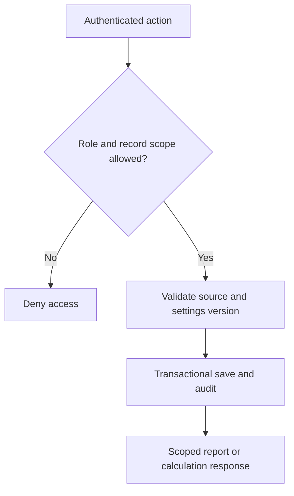

# Proposed architecture

Status: architecture proposal; no runtime services have been provisioned.

## Application boundaries

One TypeScript/Next.js application serves the public domain and role portals. One PostgreSQL database holds business records. Modules organize identity, locations, settings, daily sales/prints, attendance, payroll, reporting and audit. Private storage holds payslips and supporting documents.

| Module | Responsibility |
| --- | --- |
| Identity | Auth library, sessions, roles, record-level permissions and invitations |
| Locations | Branches/booths, dated employee assignments and approved workdays |
| Settings | Structured versions, scope/default resolution, validation, previews and publication |
| Operations | Daily branch sales, production outcomes, waste/reprints and report review |
| Attendance | Punches, shifts, breaks, payable-unit inputs and reviewed corrections |
| Payroll | Effective rates, daily commission ledger, base pay, calendar, draft/review/lock and payslips |
| Reporting | Scoped aggregate queries, details, export and transparent branch balances |
| Audit | Immutable change/publication events and protected access history |

## Request and earning flow

The server resolves role, employee and branch scope from trusted records. Hostnames select the portal experience. Each protected query, mutation, download and aggregate requires authorization.

Daily earnings reference approved branch sales, actual work assignment, employee percentage version, base-pay version, rounding and the earning date. Payroll sums those earnings over a configured period. Once approved, it stores immutable snapshots; later corrections become explicit adjustments.

## Source control and runtime data

Store source, migrations, docs, tests and synthetic config examples in `foxcyloxcy/payple-payroll-people--management`. Store live business settings and sensitive records in the database/private storage. Keep credentials in environment/secret management. An admin edit is a versioned database operation, not a repository edit.

## First implementation slice

Build login/role and record permissions, branch management, employee assignment, and admin configuration with an impact preview. Demonstrate an individual percentage change, a daily branch-sales example and both payday presets before extending reporting/payroll.

End-to-end validation must include direct unauthorized requests, cross-branch data attempts, negative after-pay balance, reprint/waste reconciliation, historical rates, missing inputs, duplicate processing and short-month schedule behavior.
