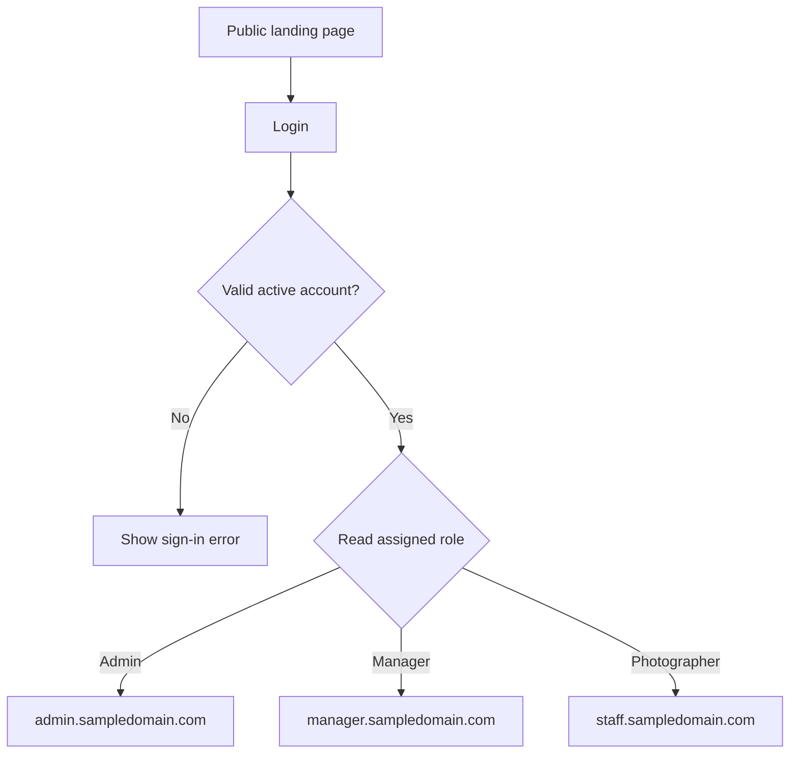

# Photography Business Management System — Initial Plan

Prepared: 6 November 2026 • Version 0.5 • Status: confirmed branch-based commission and admin-editable compensation/calendar design

## 1. What we are building

A public photography business website connected to a private business management web application. The private application brings together print reporting, attendance, payroll preparation, and management dashboards.

Suggested working name: **Photography Operations & Workforce Management System**. It has the scope of a small industry-specific ERP. It would become a SaaS product only if we later offer independently managed accounts to multiple businesses.

This document proposes an architecture and delivery sequence. It does not represent an implemented or deployed system.

## 2. Confirmed requirements and assumptions

| Confirmed by the user | Proposed default requiring confirmation |
| --- | --- |
| Public landing page at the main domain with a login button | Landing page includes services, portfolio samples, business information, and contact details |
| Three roles: admin, manager, photographer | Accounts are created or invited by admins; no public staff registration |
| Admins land at admin.sampledomain.com | Photographers land at staff.sampledomain.com |
| Managers land at manager.sampledomain.com | Managers see only their assigned locations or teams |
| Admin has report viewing and payroll management | Admin approves submitted reports and finalizes payroll |
| People can time in and time out | Staff record their own attendance on mobile browsers |
| Managers report photo-print quantities, visible to admin | Start with manual daily or shift reports, with automatic printer integration evaluated later |
| Admin sees graphs and pie charts | Use a mix of totals, trends, comparisons, charts, and drill-down tables |
| Business operates across multiple branches or booths | Model these as locations within one business; independent companies have not been requested |
| Reported quantities are copies physically printed, including reprints | Separate original copies, reprints, and any complimentary or spoiled output categories |
| Commission is an admin-set individual percentage of the daily sales of the branch where the manager or photographer works | Admin defines sales treatment (discounts/refunds/tax/collection), attendance eligibility, and handling of split-branch workdays |
| A rejected first print is waste and its replacement is a reprint | Capture waste and successful replacements separately, linked to the original sale where available |
| Payroll operates in the Philippines | Propose PHP currency and Asia/Manila business dates; confirm branch cities/provinces and applicable wage classifications |
| Payroll frequency is editable: weekly or twice monthly, including 15th/30th and 5th/20th | Admin defines cutoffs, weekly payday, short-month and non-working-day handling; preview actual dates before activation |
| Basic/minimum pay is added to commission; fixed rate is daily | Admin defines base amounts/units, individual commission percentages and whether a fixed-daily plan also has commission |
| Payroll remains payable even when the branch has a negative result for the day | Show the loss transparently; never cap employee earnings to available branch sales |

Physical production including reprints remains a required reporting measure. Daily branch sales amounts are required because commission is calculated from sales value; full stock management remains optional. Admin controls compensation arrangements, percentages, branch work assignments and payroll calendars through validated settings stored in the database. Changing these settings must not require editing application code or redeploying. The remaining choices are recorded as configurable policies and setup tasks, rather than unanswered questions about branch-based commission or minimum-pay top-ups.

## 3. Domain and navigation structure

| Address | Audience | Main pages |
| --- | --- | --- |
| sampledomain.com | Public | Home, services, portfolio, about/contact, login |
| sampledomain.com/login | Staff | Sign in, password recovery; optional multi-factor challenge |
| admin.sampledomain.com | Admin | Overview, print reports, attendance, payroll, employees, locations, approvals, settings, audit history |
| manager.sampledomain.com | Manager | Location overview, daily/shift print report, report history, team attendance, correction requests, own attendance |
| staff.sampledomain.com | Photographer; proposed | Own dashboard, time in/out, own attendance, commission statement, correction requests, own published payslips |

Suggested admin routes: /dashboard, /reports/prints, /attendance, /payroll, /employees, /locations, /approvals, /settings, /audit.

Suggested manager routes: /dashboard, /reports/new, /reports, /attendance/team, /attendance/me, /requests.

Suggested photographer routes: /dashboard, /attendance, /requests, /payslips.

Admin settings routes: /settings/company, /settings/branches, /settings/compensation, /settings/payroll-schedules, /settings/sales-rules, /settings/attendance, /settings/reporting. Employee pages link to compensation and dated branch assignments.

### Login behavior

Roles come from trusted server records. Staff cannot select an elevated role during sign-in. Disabled accounts are denied. A valid account without an assigned role gets an access-help screen. For the MVP, use one role per account, with location assignments separate from the role; revisit a portal chooser if multiple roles are needed.

The server must authorize each page, API call, export, and protected file. Typing another portal's URL or changing a branch identifier must never grant access. OWASP explicitly recommends permission checks on every request [1].

## 4. Proposed permissions

| Capability | Admin | Manager | Photographer |
| --- | --- | --- | --- |
| View operational dashboards | All locations | Assigned locations | Own relevant information |
| Create print reports | All locations, with author recorded | Assigned locations | Optional; unresolved |
| Edit draft reports | All, audited | Own drafts | Only if print entry is enabled |
| Submit print reports | Yes | Own reports | Optional |
| Approve print reports | Yes; own submissions require an explicit self-approval policy | No by default | No |
| Time in/out | Own, if attendance applies | Own | Own |
| View attendance | All staff | Assigned team | Own |
| Request attendance correction | Yes | Yes | Own records |
| Approve attendance corrections | Yes; avoid approving own request | Assigned team, if delegated; never own | No |
| Manage pay arrangements, individual commission percentages and payroll | Yes | No | No |
| Read published payslips | All, authorized access logged | Own | Own |
| Create users, assign roles and locations | Yes | No | No |
| View audit history | All | Relevant operational history if enabled | Own request history |

Salary access is a separate permission from team attendance access. Managers do not automatically get employee pay rates. All dashboard totals must use the same location and employee restrictions as their underlying records.

## 5. Print reporting and inventory

### Decide the reporting unit first

The confirmed operating model is multiple branches or booths. Propose one report per branch/booth + business date + shift, with a daily report if shifts are not used. Confirm daily versus shift reporting. If there are several managers on a shift, define one accountable submitter. Events/jobs are not required in the current scope.

### Suggested report fields

| Group | Fields |
| --- | --- |
| Identity | Branch/booth, business date, shift if used, submitted by, submission time |
| Print output | Product/size, successful original copies, successful replacement copies, waste copies; distinguish sale/free status without counting a copy twice |
| Daily sales, required | Branch/date, sales value, discounts, refunds, and the approved commission basis; use transaction records or a reconciled daily summary |
| Stock, if required | Opening stock, receipts, transfers, material consumption, waste, physical closing count, unit |
| Commission attribution | Manager/photographer, eligible daily sales basis, branch/assignment, employee percentage and effective date; required for each commission calculation |
| Review | Notes, optional supporting receipt/counter evidence, state, reviewer, review time, correction reason |

Store quantities as non-negative integers in clearly named units. Use exact decimal money values and currency, not floating-point arithmetic. Do not require customer photographs merely to record a print count.

The physical print count includes all actual outputs, including rejected originals and replacement attempts. Show it alongside usable output and waste so a defect never looks like an extra successful delivery. Use mutually exclusive outcomes: successful original, successful replacement, or waste. A failed replacement is waste, with its attempt type retained as metadata. Add sale/free status separately; do not count complimentary copies twice.

**Total physical prints = successful originals + successful replacements + waste.** A rejected original is reclassified as waste rather than retained as a successful original and counted again. Link a replacement to the original sale/job and record its reason. Neither waste nor a free replacement creates additional sales value. A charged additional sale must have its own sales record. Keep material consumption in its actual unit and never post a second waste deduction for an already recorded consumed sheet.

Workflow: **Draft → Submitted → Approved**, or **Submitted → Returned → Revised submission**. Admin sees submitted work immediately as provisional. The default official dashboard uses approved data; a status filter exposes pending data without mixing it silently into final totals. Approved records are locked. Later corrections create an auditable revision or adjustment and trigger review again.

Physical counts are observations; stock movements are transactions. Keep both so discrepancies can be investigated. This follows the distinction illustrated in Odoo's inventory adjustment and scrap workflows [5][6].

### Example: why separate counts matter

Illustrative figures only: 100 paid copies are ordered. Of 100 first attempts, 90 are usable and 10 are rejected. Ten replacement attempts are successful. Report **110 physical prints, 100 usable copies, 10 waste copies, and 10 successful reprints**. The 10 reprints are already part of the 100 usable copies and must not be added to usable output again. There are still 100 paid copies, with the original sales amount. Commission is the employee's configured percentage of the agreed daily sales basis, never automatically a multiple of the 110 physical attempts.

For sheet stock: **expected closing = opening + receipts + transfers in − transfers out − total consumption ± approved adjustments**. Physical closing minus expected closing is the variance.

If materials are rolls, ribbons, or kits, define unit conversions and usable yield; a generic one-print-equals-one-sheet rule will be wrong. Refunds do not automatically replenish consumed materials.

## 6. Admin dashboard and reports

| Business question | Recommended presentation | Data needed |
| --- | --- | --- |
| How many physical prints did we produce today? | Total card plus trend, with usable/waste totals adjacent | Approved physical attempts, outcomes, and business dates |
| Which locations have the most output? | Ranked bar chart | Output by location |
| Which print sizes make up total output? | Donut/pie for a few sizes; bar chart if numerous | Mutually exclusive product categories |
| How much output is waste or replacement work? | Outcome breakdown; waste and reprint rate cards | Successful originals, successful replacements, waste, and labeled denominators |
| How much commission has been earned? | Employee/branch breakdown and period total | Eligible records, attribution, reviewed policy and rates |
| How are sales changing? | Daily/weekly line chart | Required daily sales, discounts, refunds, and defined sales basis |
| Who is currently clocked in? | Status cards and staff table | Open attendance sessions |
| What needs action? | Pending reports, missing punches, correction queue | Submission and attendance states |
| How much payroll is due? | Pay-period totals and breakdown table | Reviewed payroll calculations |
| Did payroll exceed branch sales today? | Daily sales, accrued base pay, commission and after-pay balance table; negative balances remain visible | Branch sales and employee earnings allocated to earning dates |
| Where is stock running low? | Location/product table and alerts | Confirmed inventory scope and thresholds |

Chart selection follows the question: trends over time, comparisons between locations, or shares of a whole [7][8]. Every chart should show its unit, date range, location scope, approval basis, last refresh time, and a link to the underlying table. Provide a table alternative for accessibility.

Start with date range, branch/booth, product/print size, output category, and report-state filters. Add photographer filtering when attribution is collected consistently; that attribution is needed if commissions are individual. Reports update after a successful save/approval through refresh or short polling; printer-driven real-time telemetry is a separate integration.

Do not label sales as profit. Profit needs agreed material costs, payroll allocation, operating costs, and accounting rules.

The user's reference to a negative day's result means the business can spend more on earnings/costs than it receives in sales. Keep sales, expenses and result as separate figures. **Sales less accrued employee earnings** is an after-pay balance; label it as such until the system has the other costs needed for a profit/loss calculation. Attribute payroll expense to the date it was earned so paying a two-week payroll on one day does not distort every daily result. Do not hide losses or automatically reduce pay when that balance is negative.

## 7. Attendance workflow

1. Employee signs in, selects an authorized location/assignment where needed, and taps Time In.
2. The server records the timestamp and creates one open work session. Duplicate taps or retries must return the existing result.
3. Employee records breaks if the business requires them, then taps Time Out.
4. The system calculates elapsed duration and flags missing punches, overlaps, or unusual sessions for review.
5. Employee requests corrections with a reason. An authorized reviewer approves or rejects; original punches remain in history.
6. Reviewed work records support basic/fixed pay where attendance is applicable, and commission eligibility only where an agreed assignment/attendance rule requires it. Attendance does not automatically reduce or redistribute sales commission.

Store timestamps in UTC and derive business dates in the configured location timezone. Support shifts crossing midnight. Do not use a phone's editable clock as the authoritative punch time. Lateness requires a scheduled start time; working beyond a duration threshold does not automatically mean approved paid overtime.

Choose between personal-device clocking and a shared kiosk/QR workflow. Location checks or selfies are optional requirements, not assumptions. Define what happens without internet; the initial proposal requires connectivity and offers a correction request for missed punches.

## 8. Payroll workflow and boundaries

Payroll depends on confirmed pay rules, rather than raw attendance totals alone. Odoo's payroll model similarly separates employee arrangements, work entries, conflict resolution, and payslip processing [3][4].

Proposed sequence: **Open period → Resolve attendance issues → Calculate draft → Review → Approve and lock → Publish payslips → Record payment**.

The user confirmed the Philippines, individual percentages of the daily sales of the branch where each person works, basic/minimum pay plus commission, fixed daily rates, and configurable weekly or twice-monthly payroll. Supported examples include the 15th/30th and 5th/20th. Admin controls these settings per manager or photographer. Propose PHP amounts and Asia/Manila dates. Pay frequency controls payout aggregation; it does not change how a daily commission is earned.

### Admin compensation settings

| Setting | Required behavior |
| --- | --- |
| Employee and role | Select a manager or photographer and view their effective location assignments |
| Pay arrangement | Basic pay plus commission, minimum base plus commission, or fixed daily rate; commission can be enabled/disabled explicitly on fixed daily plans |
| Base/fixed amount and unit | Fixed-rate unit is daily; admin selects and stores the basic/minimum base unit and attendance conversion rule |
| Commission percentage | Configurable individually, including zero when commission is disabled; no hardcoded global percentage |
| Eligible sales basis | Daily sales of the branch worked, using a versioned admin-configured gross/net/collection policy and source record |
| Minimum-pay meaning | Confirmed as minimum base added to commission; do not implement an either/or earnings floor |
| Payroll schedule | Weekly or two editable monthly paydays, e.g. 15/30 or 5/20; separate cutoffs and calendar exceptions |
| Effective date and reason | Version changes; retain historical rates and prevent accidental retroactive recalculation |

For basic or minimum-base pay plus commission, ordinary earnings are **earned base pay + daily branch-sales commissions**. Minimum pay is additive, as confirmed by the user. A fixed-rate plan uses **daily rate × approved payable day units**, plus commission when explicitly enabled in that plan. Store any partial-day rules rather than inferring them. Other applicable earnings and lawful deductions remain separate payslip lines. Keep business losses visible and do not reduce these earnings to make a branch balance positive.

Company pay-plan labels are separate from the applicable statutory minimum wage rules. A configurable label does not establish wage compliance. Define overtime, holidays, leave, allowances, advances, deductions, benefits, and contribution/tax scope before live payroll. Role names such as manager do not by themselves establish statutory coverage.

### Commission design

1. Record daily sales alongside print output, waste, and replacements. Choose transaction entry or a reconciled daily sales summary during prototype design.
2. Determine the branch where each manager or photographer actually worked that business date, using approved dated work assignments and attendance. Use that branch's daily sales. A later transfer does not reassign historical sales. Multiple people working the same branch can each receive their independently configured percentage; their rates are not automatically a divided pool.
3. Apply that employee's percentage effective on the sales earning date. A rate change updates future earnings; approved historical calculations retain their original policy/rate snapshots.
4. Calculate **daily commission = eligible daily sales amount × employee percentage / 100**. Specify treatment of discounts, refunds, taxes, unpaid sales and free replacements in the sales-basis definition.
5. Store a unique ledger entry per source revision, earning date, employee and policy. Sum reviewed daily entries for the payout period. Repeated processing must not duplicate earnings.
6. Combine the period commission with the confirmed base/minimum/fixed-pay arrangement, review and lock payroll, publish the statement, and record payment separately.

Illustrative rates only: on eligible branch daily sales of PHP 10,000, a manager working there at 3% earns PHP 300 commission and a photographer working there at 5% earns PHP 500 commission. Add each person's earned base separately. These are independent percentages of that branch's sales, not automatically pool shares. For a person working multiple branches on one date, require an explicit admin-selected policy (primary branch, allocated branch-day fractions, or approved per-branch work segments) and preview it; do not silently double count. Record attendance/assignment exceptions for review rather than assuming a missing punch means zero earned commission.

Waste and replacement attempts affect production and material reporting. They do not increase daily sales or create extra sales commission unless a genuine additional charged sale is recorded. Waste recording does not automatically create a payroll deduction. After payroll is locked, source corrections or refunds create explicit reviewed adjustments rather than silently rewriting a paid period.

### Payroll calendar and Philippine wage configuration

Support weekly schedules and twice-monthly schedules with admin-selected days such as **15/30** or **5/20**. Keep exact day 30 distinct from an optional last-day-of-month setting; day 30 falls back to the month's last day in February under an explicit short-month policy. Store earning-period cutoffs separately from payout dates, and configure weekly payday, weekends/holidays, processing lag and schedule changes without omitted or duplicated earning dates. Preview a full calendar including February and year boundaries before activating a schedule. DOLE's published Article 103 provides for wage payments at least every two weeks or twice monthly, at intervals not exceeding sixteen days [10]. Validate generated payment gaps, including after non-working-day adjustments, against applicable requirements.

Minimum wage settings must reference each branch's city/province/region, applicable establishment category and coverage, wage-order effective date, and rate unit. NWPC publishes regional wage orders and rates [11]; do not hardcode one national amount or apply today's rate to old earning dates. No statutory rate is selected here because branch locations and categories are not provided. Keep statutory wage checks distinct from the company's optional minimum-pay guarantee, and validate the actual compensation treatment with the payroll owner against applicable rules.

SSS, PhilHealth, Pag-IBIG, withholding tax, 13th-month pay, leave/holiday pay and other applicable benefits need an explicit inclusion/coverage decision and current official rule research before production calculations. Their formulas have not been implemented or established by this plan.

Use effective-dated pay rates and rule versions. Each approved payroll stores its source attendance/report revisions, calculation lines, rounding rules, and rates. Later rate edits must not silently change an old payslip. Handle post-approval corrections through documented adjustments.

Initial recommendation: payroll calculation, review, payslip generation, and payment recording/export. Direct bank disbursement and government filing remain separate scope decisions. Publishing a payslip does not mean an employee has been paid.

### Admin configuration lifecycle

Use structured forms and policy types rather than arbitrary executable formulas. Company defaults can feed branch templates; an employee's explicit pay/commission version overrides the relevant default. Display the resolved values and their source. Resolve branch sales from the branch actually worked on the earning date, not from the payroll schedule or current home branch.

The lifecycle is **Draft → Validate → Preview impact → Publish with an effective date → Retain history**. Validation covers monetary precision, percentage limits, missing branch sales, overlapping rate versions, branch-workday conflicts, schedule dates and authorization. Preview a worked example and affected draft payroll before publishing. Changing settings applies prospectively; approved historical payroll keeps its snapshots, with reviewed adjustments for later corrections. Admin sees who changed what, when, why and when it takes effect. Managers and photographers can read their permitted statements but cannot edit compensation settings.

Admin settings and employee/payroll data live in the application database with audit history. GitHub contains application code, migrations, documentation, tests and synthetic examples. A saved admin setting does not need a Git commit or application redeployment. Statutory configuration must retain source/effective date and validation; an editable field must not silently disable required access controls or rewrite finalized records.

## 9. Technical architecture

Recommended starting point: **one TypeScript/Next.js application, one PostgreSQL database, and clearly separated business modules**, serving the main domain and the three portals through explicit host routing. Subdomains do not require independent applications or databases.

| Layer | Proposal | Purpose |
| --- | --- | --- |
| UI | Next.js, TypeScript, Tailwind CSS, shadcn/ui | Shared components and responsive portals |
| Server | Next.js server modules and route handlers | Validated operations and centralized authorization |
| Database | PostgreSQL with Prisma or Drizzle; select one | Transactional reports, attendance, payroll |
| Authentication | Better Auth candidate; verify against final hosting and security requirements | Account lifecycle, sessions, recovery, optional MFA |
| Charts | Recharts candidate | Trends, comparisons, and composition charts |
| Documents | Private object storage | Protected payslips, exports, and optional evidence |
| Jobs | Retryable scheduled/background jobs when needed | Payslip batches, notifications, scheduled summaries |
| Delivery | Git repository, CI, separate staging/production, managed hosting | Reviewable releases and environment separation |

These are proposed technology choices, not claims that one vendor is required. Next.js documents library-based authentication and server-side data access checks [2].

### Authentication across subdomains

Prove cross-subdomain login in the foundation milestone. Better Auth documents shared parent-domain cookies and explicit trusted origins [9]. If adopted here, restrict origins to the actual production hosts, use secure HttpOnly cookies, retain CSRF protection, and keep every sibling subdomain under business control. A parent-domain cookie is sent to sibling hosts; review all subdomains before choosing this model. If any sibling is untrusted, use an established SSO approach with host-scoped sessions instead.

Do not put session tokens in redirect URLs. Validate hosts and allowlist role destinations. Each portal calls same-origin application endpoints to reduce unnecessary cross-origin configuration. A host identifies the portal; the authenticated account and its permissions determine access.

### Suggested repository modules

| Area | Responsibility |
| --- | --- |
| src/app | Public pages, portal layouts, route handlers |
| src/modules/identity | Accounts, sessions, roles, permissions, assignments |
| src/modules/operations | Branches/booths, products, daily sales, print outcomes, waste, reprints and revisions |
| src/modules/attendance | Punches, work sessions, breaks, correction requests |
| src/modules/payroll | Commission policies and ledger, pay arrangements, periods, calculations, approvals, payslips |
| src/modules/reporting | Scoped dashboard queries and exports |
| src/modules/audit | Actor, action, before/after values, reasons |
| src/components | Shared form, navigation, table, and chart components |
| prisma or drizzle | Schema and versioned migrations; choose one |
| tests | Authorization, accounting of quantities, attendance, payroll, and browser flows |
| docs | Requirements, architecture, admin settings specification, decisions, progress, deployment/recovery guide |

Keep policy checks and business rules in server modules, reusable by all portals. Avoid microservices until an operational need justifies them.

## 10. Initial data model

| Entities | Key relationships and constraints |
| --- | --- |
| users, sessions, employees | Authentication identity separate from employment and compensation records |
| roles, permissions, role_permissions | Exactly the three initial business roles; admin-controlled assignment |
| locations, employee_assignments | Branches/booths, effective dates, manager location scope, employee team membership and location transfers |
| products / print_types | Size, unit, active status; historical records preserve product details |
| shifts | Optional reporting and attendance unit within branches/booths; events/jobs deferred unless later requested |
| print_reports, print_report_lines, report_revisions | Reporting unit, author, state, version, reviewer; prevent duplicate active reports for the same agreed unit |
| daily_sales, sales_revisions | Required branch/date sales summary or aggregate of transactions, discounts/refunds, approval and commission basis |
| sales and sale_lines | Required if transaction-level entry is selected; otherwise retain supporting references for daily summaries |
| print_attempts or output_lines | Original/replacement attempt, usable/waste outcome, reason, quantity, product and linked sale/work reference |
| inventory_movements, physical_counts | Optional inventory module; product, location, unit, signed movement and source reference |
| attendance_punches, work_sessions, breaks | Immutable original punches; one open session per employee; overnight support |
| attendance_corrections | Requester, proposed change, reason, reviewer, state |
| work_schedules, leave_records | Required when pay or attendance exceptions depend on expected work |
| pay_arrangements, pay_rule_versions | Employee basic/minimum base plus commission, fixed daily amount, commission toggle, base unit/conversion, effective dates and reason |
| commission_policies, employee_commission_rates | Eligible daily sales definition, individual manager/photographer percentage, effective dates and attribution rules |
| commission_entries | Employee, daily sales source and revision, eligible amount, percentage snapshot, earned commission, adjustment reference and assigned payroll run; uniqueness prevents duplication |
| payroll_schedules, payroll_calendar | Weekly/twice-monthly schedules, earning cutoffs, paydays, holiday handling and effective dates |
| wage_rate_versions | Applicable location/category wage order, coverage, effective dates, reference and rate unit; separate from company guarantees |
| payroll_periods, payroll_runs, payroll_items | One active approved result per employee/period; source revision and rate snapshots |
| payslips, payment_records | Private published documents and separately recorded payments |
| audit_events | Actor, timestamp, entity, action, change, reason; restrict editing and access |
| configuration_versions, configuration_publications | Company/branch/employee scope, structured payload, schema version, draft/published state, effective dates, preview reference, actor and reason |

Use transactions for report submission with associated stock movements and for payroll approval. Add idempotency keys to retryable operations. If this becomes a multi-business product, add company membership and company isolation to every relevant entity before onboarding other businesses.

## 11. Delivery sequence and exit criteria

| Milestone | Deliverable | Ready when |
| --- | --- | --- |
| 1. Requirements and prototype | Confirm roles, reporting units, print meanings, pay rules; mobile form/dashboard wireframes | Business owner can walk through a real shift and pay period |
| 2. Foundation | Landing page, login, invitations, account recovery, subdomain routing, permissions, location assignments, audit base | Each role lands correctly; unauthorized pages, APIs, exports, and records are blocked |
| 3. Print and sales operations | Products, daily/shift production and sales reports, waste/reprint tracking, employee sales attribution, review, charts and exports; stock only if confirmed | Branch sales and physical counts reconcile; the commission source is traceable |
| 4. Attendance | Mobile time in/out, breaks if needed, correction review, period summaries | Duplicate punches, overnight sessions, and missing time-outs work correctly |
| 5. Payroll | Individual percentage settings, basic/minimum/fixed rules, weekly/twice-monthly calendar, draft/review/lock, payslips, payment recording | Representative pay arrangements, rate changes and both schedules match independently prepared expected results |
| 6. Pilot and release | Limited rollout, parallel checking, recovery rehearsal, staff guide | Owner accepts end-to-end operation and a backup restore has been demonstrated |

Milestone 1 starts from confirmed branch-sales percentage commission per person, minimum/basic pay added to commission, fixed daily pay, loss transparency, and admin-defined weekly or twice-monthly calendars. Build the settings design and validation alongside the foundation; the first working admin screens should create branches, assign staff, configure compensation and preview payroll calendars. Remaining setup choices include gross/net sales policy, split-branch workdays, basic/minimum rate units, cutoffs and statutory scope. Payroll design starts in milestone 1 because it influences attendance and sales attribution; collect required daily sales in milestone 3. Live payroll use starts only after the agreed rules and representative examples are validated. Provide a duration and cost estimate after the remaining scope decisions.

## 12. Essential validation and operational controls

- Direct URL access and manipulated IDs cannot cross role, location, or employee boundaries. Test downloadable files and chart aggregates as well as pages.
- Role changes and deactivation revoke or refresh existing access promptly. Require MFA for admin accounts in the proposed production baseline.
- A manager submits 100 copies for an authorized location. Admin sees one submitted report; after approval the official chart and export both show 100. Retrying submission never produces 200.
- Different product sizes and units remain identifiable. Reprints, spoilage, transfers, and count adjustments reconcile without double deduction.
- A branch with 90 successful originals, 10 rejected originals and 10 successful reprints shows 110 physical attempts, 100 usable copies, 10 waste copies and 10 successful reprints. Sales and commission do not increase solely because a replacement was printed.
- Each employee's commission equals the agreed eligible daily sales amount times their effective individual percentage. A photographer moving between booths keeps the correct sales attribution, historical assignment and policy rate.
- Rate changes mid-period retain the right percentage for each earning date. Daily commission entries reconcile to the period statement and cannot be processed twice.
- Weekly and twice-monthly calendars cover all earning dates once, handle month-end and February, and distinguish cutoff from payday. Verify both 15/30 and 5/20 schedules, short-month fallback and date-gap validation.
- Minimum base plus commission remains additive even if branch sales less earnings is negative. Loss reports preserve the negative balance without changing employee earnings. Fixed daily earnings use approved payable day units.
- Changing an employee's percentage or schedule through a published settings version changes eligible future drafts while locked payroll and old statements retain their original values.
- Pending, returned, and approved records remain distinguishable. Corrections preserve original data and invalidate affected approvals where required.
- Two simultaneous clock-in requests create one open session. Midnight crossing, missing time-out, and correction approval have explicit expected results.
- Pay-period boundaries, rate changes, rounding, and any commissions match approved sample calculations. Re-running a job does not duplicate payroll or payments.
- Published payslips remain private; changing a document ID does not reveal another employee's document.
- Backups are stored separately from the application host. Define acceptable data loss and restore time with the owner; perform and document a restore test.
- Monitor application errors, failed jobs, missing reports, and payroll exceptions. Define retention for employee records, payroll, supporting documents, and audit events.
- Separate production credentials and employee data from development. Decide whether existing spreadsheets need import and validation.

## 13. Questions to resolve

| Priority | Question | Why it changes the design |
| --- | --- | --- |
| Resolved | Physical prints include replacements; a rejected original is waste | Display physical attempts, usable output, waste and replacements without double counting |
| Resolved | Operating model: multiple branches or booths | Model branch assignments and admin totals across locations; actual location/staff counts remain open |
| Resolved | Percentage of daily sales, with admin-set rates per manager or photographer | Required daily sales and individual effective-dated commission settings |
| Resolved | Each person's percentage uses sales of the branch where they work | Preserve actual work assignments by earning date; handle transfers and split days explicitly |
| Resolved | Minimum pay is added to commission; fixed rate is daily; losses are allowed and transparent | Do not cap earned pay to branch sales; show a separately labeled negative after-pay result |
| Resolved | Admin-editable schedules include weekly, 15/30 and 5/20 | Store actual paydays separately from earning cutoffs; preview short months and non-working days |
| Admin setup | Gross versus net sales, discounts/refunds/tax/collection treatment, and split-branch workday policy | Use a published versioned policy, with clear examples and reconciliation |
| Admin setup | Basic/minimum amount and rate unit, fixed-daily commission toggle, cutoff periods and calendar exceptions | Configure employee arrangements without code changes; preview outcomes before publication |
| Before payroll | Where are the branches (city/province), what establishment categories and staff arrangements apply? | Determines applicable regional wage rules and statutory coverage |
| Before prototype | What should photographers do beyond clocking in/out and viewing their own records? | Defines their portal and output attribution |
| Before prototype | Should reporting happen per sale, per shift, per day, or per event? Is manual entry enough initially? | Defines form complexity, duplicate rules, and integrations |
| Before prototype | Is daily sales entry a branch summary or per transaction? Are cash/payment reconciliation and refunds managed here? | Daily sales are required; full point-of-sale and payment functionality remain separate scope |
| Before attendance | Personal phones, shared kiosk, QR, location checks, or another method? Is internet reliable? | Defines clocking and missed-punch workflows |
| Before attendance | Are schedules, breaks, leave, overtime, and lateness required? | Defines attendance interpretation and pay inputs |
| Before payroll | Who approves reports, attendance changes, and payroll? Can a person approve their own entry? | Defines review permissions and workflow |
| Before payroll | Calculation and payslips only, or also bank disbursement, statutory deductions, and filings? | Changes implementation and integration scope substantially |
| Before build commitment | Business name/domain, preferred hosting, budget, target date, existing spreadsheets and devices? | Defines deployment, migration, and delivery constraints |

## Repository and ongoing work

Selected repository: **[foxcyloxcy/payple-payroll-people--management](https://github.com/foxcyloxcy/payple-payroll-people--management)**, supplied by the user. The existing repository is public; preserve its selected visibility. Store the plan, architecture, admin-settings specification, decision log, delivery status and later source/tests/migrations there. Each completed implementation step should be committed and pushed to this repository. Do not treat a local commit as a successful push; verify the remote commit. Repo creation/publication status is recorded separately from application implementation and deployment status.

## 14. Research references

Research checked on 6 November 2026. These references inform the design; the proposed permissions, schema, and delivery order are recommendations for this business.

1. [OWASP Authorization Cheat Sheet](https://cheatsheetseries.owasp.org/cheatsheets/Authorization_Cheat_Sheet.html) — access enforcement and authorization testing.
2. [Next.js authentication guide](https://nextjs.org/docs/app/guides/authentication) — authentication libraries, sessions, and authorization placement.
3. [Odoo Payroll](https://www.odoo.com/documentation/19.0/applications/hr/payroll.html) — example of connected payroll and employee work data.
4. [Odoo work entries](https://www.odoo.com/documentation/19.0/applications/hr/payroll/work_entries.html) — work record conflicts and payroll inputs.
5. [Odoo inventory adjustments](https://www.odoo.com/documentation/19.0/applications/inventory_and_mrp/inventory/management/inventory_adjustments.html) — physical counts and reconciliation.
6. [Odoo scrap inventory](https://www.odoo.com/documentation/19.0/applications/inventory_and_mrp/inventory/warehouses_storage/inventory_management/scrap_inventory.html) — explicit material loss records.
7. [Datawrapper line chart guidance](https://www.datawrapper.de/blog/line-charts) — change over time versus category comparisons.
8. [Atlassian bar chart versus pie chart guidance](https://www.atlassian.com/data/charts/how-to-choose-pie-chart-vs-bar-chart) — comparisons and parts of a whole.
9. [Better Auth cookies](https://better-auth.com/docs/concepts/cookies) — cross-subdomain session configuration and trust considerations.
10. [DOLE Labor Code, Book III](https://dole.gov.ph/book-3-conditions-of-employment/) — regional minimum wages and Article 103 payment frequency; retrieved through indexed official content on 6 November 2026 (direct fetch returned HTTP 403).
11. [National Wages and Productivity Commission](https://nwpc.dole.gov.ph/) — regional wage matrices, applicable categories and effective-dated wage orders; no branch-specific rate selected in this plan.
